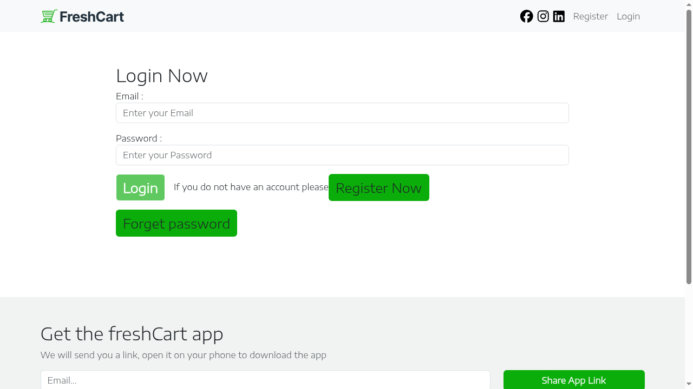

# E-Commerce (React)

A responsive e-commerce store built with React, consuming a live product API. Users can browse products, filter by category and brand, search, manage a cart and wishlist, register and log in, and place orders with a shipping address.



**Live demo:** https://moazkandeel.github.io/E-Commerce/

## Features

- Product catalog with categories, brands, search and product details pages
- Cart and wishlist with add/remove and quantity updates
- Full auth flow: register, login, forgot/reset password (JWT), protected routes
- Checkout with shipping address and order history
- Loading spinners, toast notifications, offline detection

## Tech stack

React 18, React Router 6, React Query, Axios, Formik + Yup, Bootstrap 5, styled-components, react-slick, Font Awesome

## Run locally

```bash
npm install
npm start
```

The app runs on http://localhost:3000 and talks to a public products API.
